# 04 · AppFlow — Flujos de la aplicación

**Producto:** NautiFlow · **Versión:** 1.0 (MVP) · **Fecha:** 16/10/2026

Los diagramas están en sintaxis **Mermaid** (se renderizan en GitHub, GitLab, Notion, VS Code con extensión, mermaid.live).

---

## 1. Vista general del ecosistema

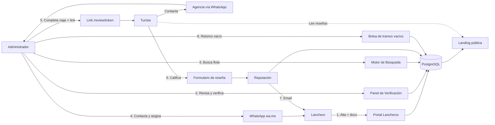

## 2. Flujo A — Alta y verificación del lanchero

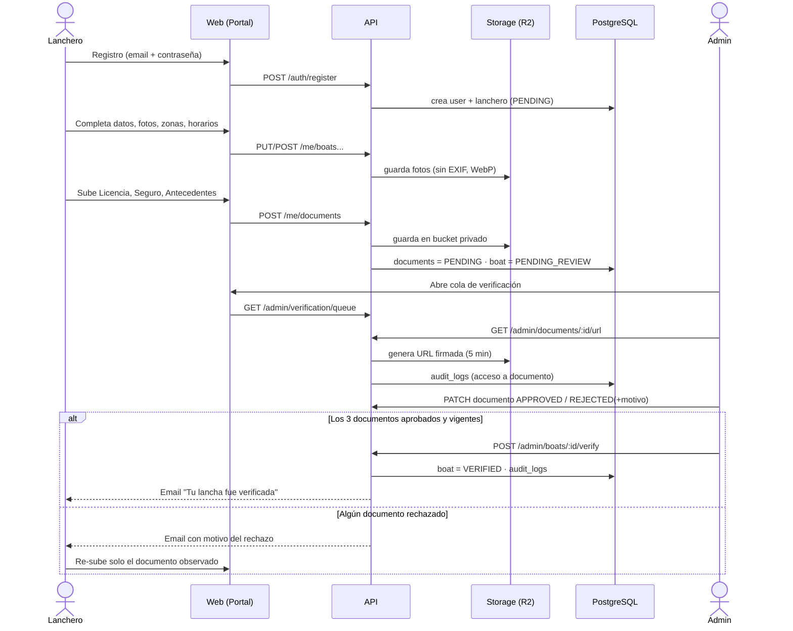

### Máquina de estados — Documento

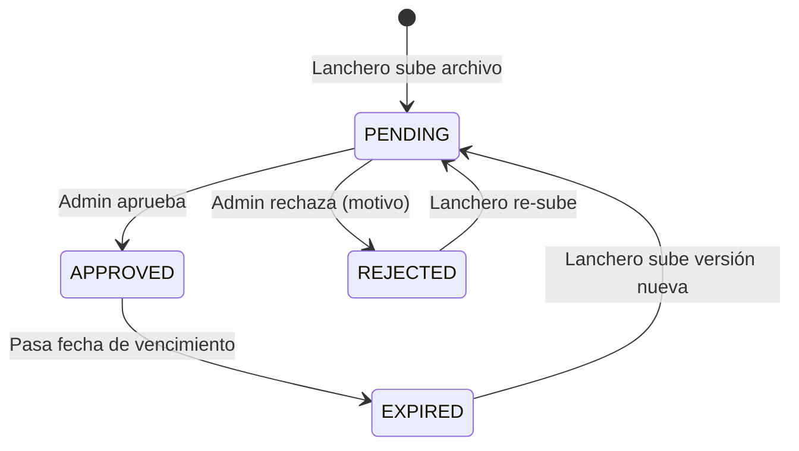

### Máquina de estados — Lancha (verificación)

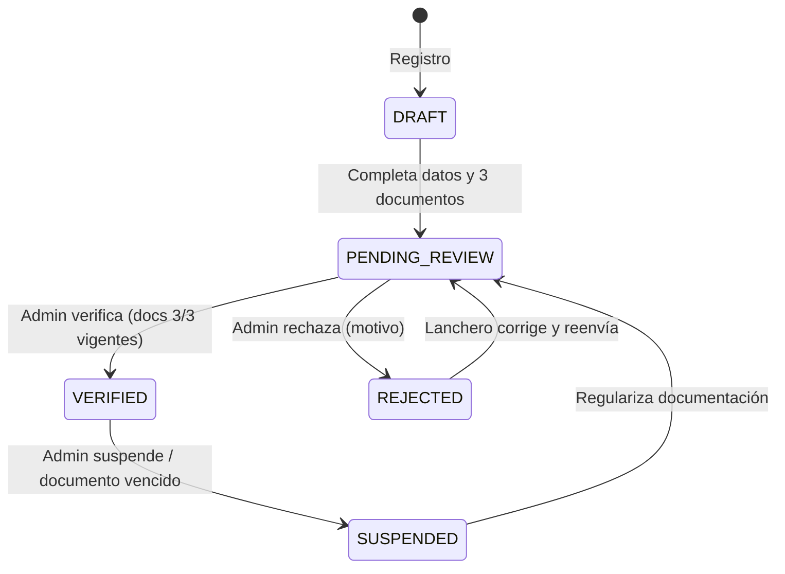

## 3. Flujo B — Búsqueda y asignación

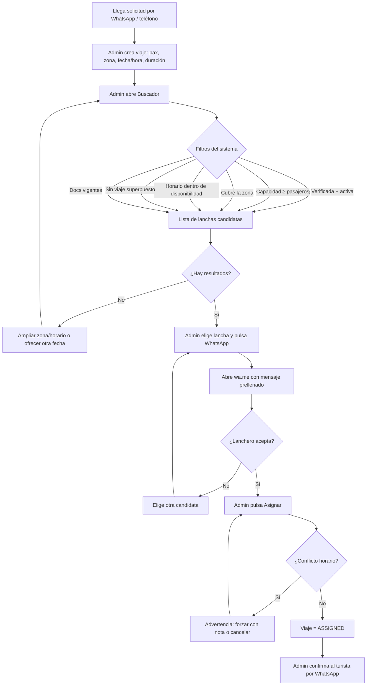

## 4. Flujo C — Ciclo de vida del viaje

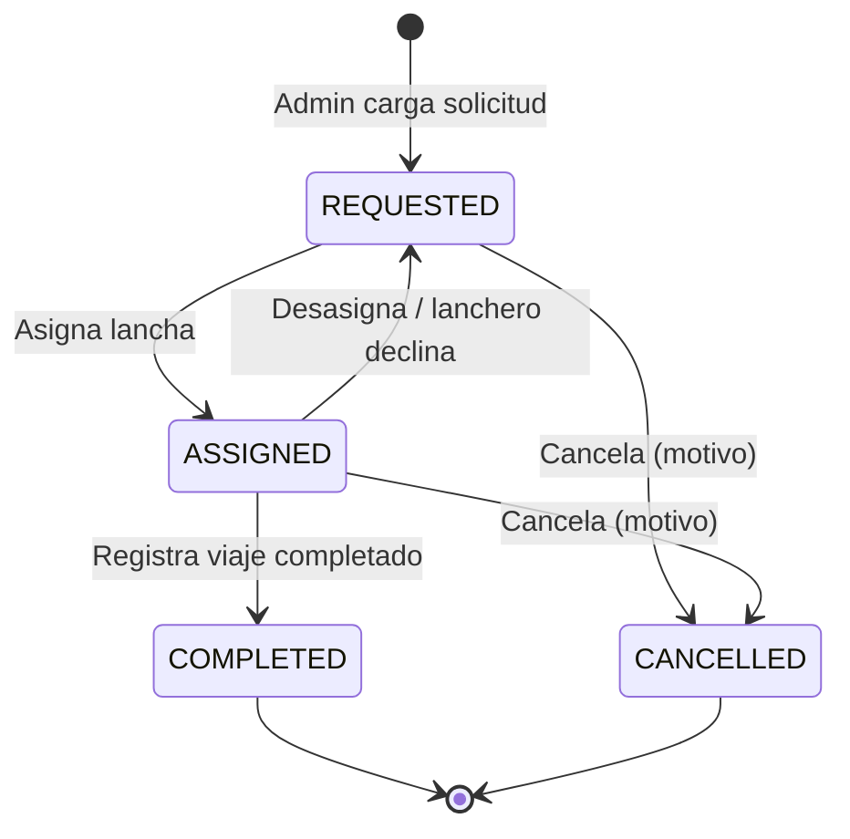

Acciones habilitadas por estado:

| Estado | Acciones del admin |
|--------|-------------------|
| `REQUESTED` | Buscar lancha, editar, cancelar |
| `ASSIGNED` | Completar, desasignar, cancelar, **Publicar retorno vacío** |
| `COMPLETED` | **Generar link de reseña**, publicar retorno vacío (si aún aplica) |
| `CANCELLED` | Solo lectura |

## 5. Flujo D — Reseña con token y reputación

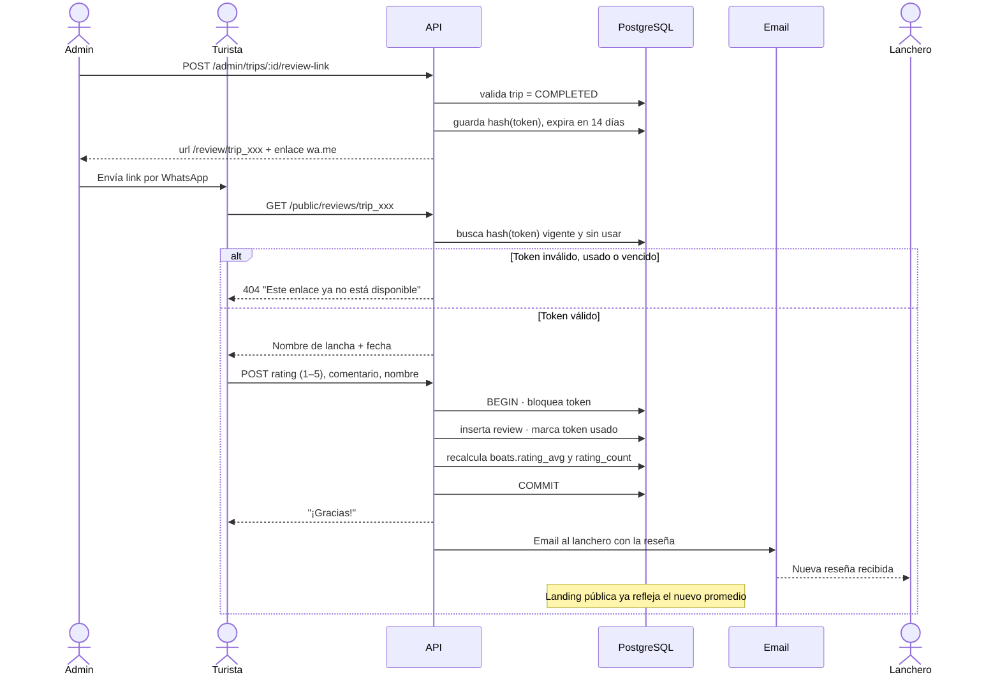

### Estados del token

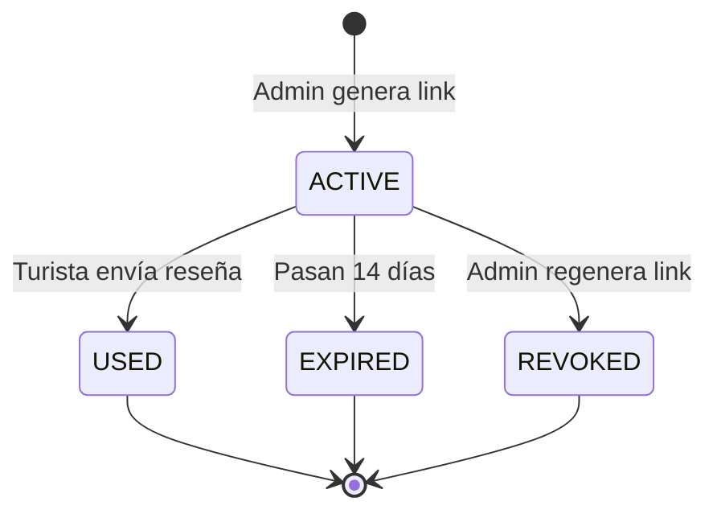

## 6. Flujo E — Moderación de reseñas

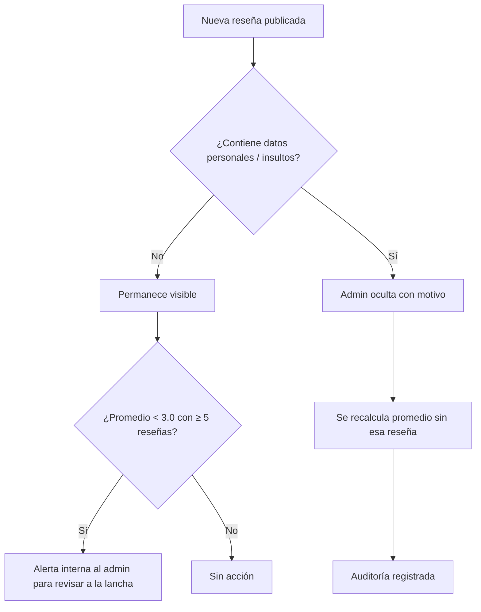

## 7. Flujo F — Bolsa de tramos vacíos

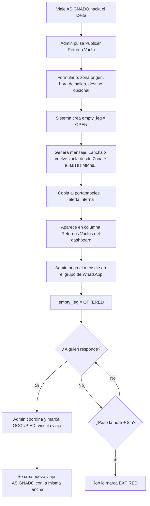

### Estados del tramo vacío

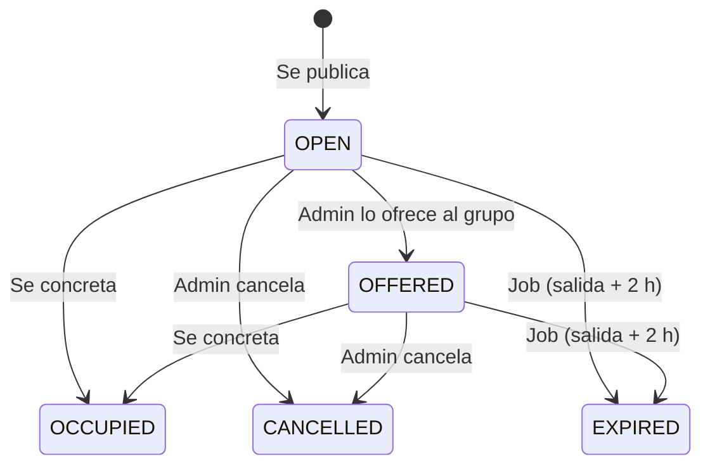

## 8. Flujo G — Vencimiento de documentación (automático)

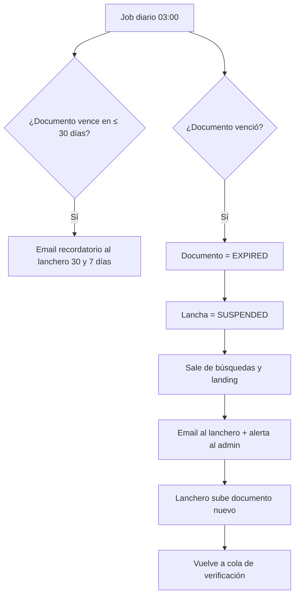

## 9. Matriz de permisos

| Recurso / Acción | Público | Lanchero | Admin |
|------------------|:------:|:--------:|:-----:|
| Ver landing y reseñas visibles | ✔ | ✔ | ✔ |
| Enviar reseña (con token válido) | ✔ | — | — |
| Registrarse / editar su lancha | — | ✔ (propia) | ✔ |
| Subir documentos | — | ✔ (propios) | ✔ |
| Ver documentos | — | ✔ (propios) | ✔ |
| Aprobar / rechazar documentos | — | — | ✔ |
| Buscar flota, ver teléfono | — | — | ✔ |
| Crear / asignar / completar viajes | — | — | ✔ |
| Generar link de reseña | — | — | ✔ |
| Ver reseñas recibidas | — | ✔ (propias) | ✔ |
| Moderar reseñas | — | — | ✔ |
| Publicar / gestionar retornos vacíos | — | — | ✔ |
| Ver datos de contacto del turista | — | — | ✔ |
