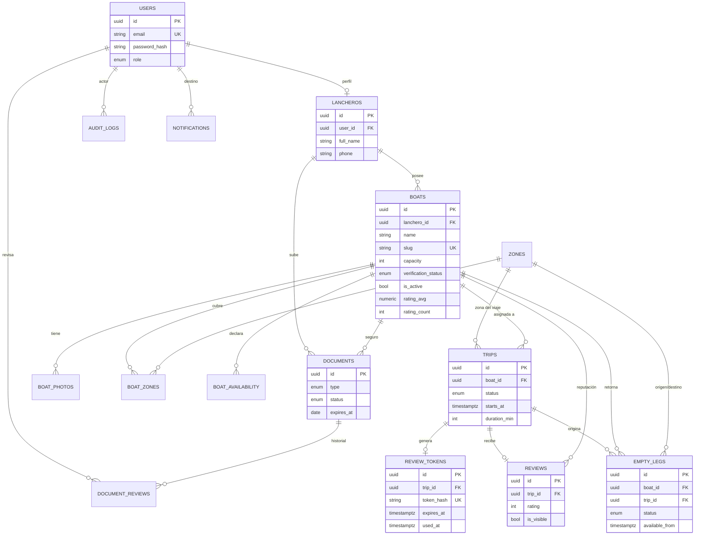

# 05 · Backend Schema

**Producto:** NautiFlow · **Motor:** PostgreSQL 16 · **ORM:** Sequelize 6 (ES Modules) · **Versión:** 1.0 (MVP)

Convenciones: tablas en `snake_case` plural, claves primarias `UUID` (`gen_random_uuid()`), fechas en `timestamptz` (UTC), valores de estado en inglés en la base y traducidos en la UI.

---

## 1. Diagrama entidad-relación



## 2. DDL (PostgreSQL)

> En el proyecto real se implementa con **migraciones de Sequelize** (`sequelize-cli`). Este DDL es la referencia canónica y sirve para revisar índices y restricciones.

```sql
CREATE EXTENSION IF NOT EXISTS pgcrypto;   -- gen_random_uuid()
CREATE EXTENSION IF NOT EXISTS citext;     -- emails case-insensitive

-- ───────── Tipos enumerados ─────────
CREATE TYPE user_role           AS ENUM ('ADMIN', 'LANCHERO');
CREATE TYPE verification_status AS ENUM ('DRAFT', 'PENDING_REVIEW', 'VERIFIED', 'REJECTED', 'SUSPENDED');
CREATE TYPE document_type       AS ENUM ('LICENSE', 'INSURANCE', 'CRIMINAL_RECORD');
CREATE TYPE document_status     AS ENUM ('PENDING', 'APPROVED', 'REJECTED', 'EXPIRED');
CREATE TYPE trip_status         AS ENUM ('REQUESTED', 'ASSIGNED', 'COMPLETED', 'CANCELLED');
CREATE TYPE empty_leg_status    AS ENUM ('OPEN', 'OFFERED', 'OCCUPIED', 'EXPIRED', 'CANCELLED');
CREATE TYPE token_status        AS ENUM ('ACTIVE', 'USED', 'EXPIRED', 'REVOKED');

-- ───────── Usuarios ─────────
CREATE TABLE users (
  id             UUID PRIMARY KEY DEFAULT gen_random_uuid(),
  email          CITEXT NOT NULL UNIQUE,
  password_hash  TEXT   NOT NULL,
  role           user_role NOT NULL DEFAULT 'LANCHERO',
  is_active      BOOLEAN NOT NULL DEFAULT TRUE,
  failed_logins  SMALLINT NOT NULL DEFAULT 0,
  locked_until   TIMESTAMPTZ,
  last_login_at  TIMESTAMPTZ,
  created_at     TIMESTAMPTZ NOT NULL DEFAULT now(),
  updated_at     TIMESTAMPTZ NOT NULL DEFAULT now()
);

CREATE TABLE password_resets (
  id          UUID PRIMARY KEY DEFAULT gen_random_uuid(),
  user_id     UUID NOT NULL REFERENCES users(id) ON DELETE CASCADE,
  token_hash  CHAR(64) NOT NULL UNIQUE,
  expires_at  TIMESTAMPTZ NOT NULL,
  used_at     TIMESTAMPTZ,
  created_at  TIMESTAMPTZ NOT NULL DEFAULT now()
);

-- ───────── Lanchero (conductor) ─────────
CREATE TABLE lancheros (
  id                UUID PRIMARY KEY DEFAULT gen_random_uuid(),
  user_id           UUID NOT NULL UNIQUE REFERENCES users(id) ON DELETE CASCADE,
  full_name         VARCHAR(120) NOT NULL,
  phone             VARCHAR(20)  NOT NULL,      -- E.164 sin '+': 5491155551234
  dni_last4         CHAR(4),                    -- opcional, solo para referencia visual (no el DNI completo)
  consent_data_at   TIMESTAMPTZ NOT NULL,       -- consentimiento Ley 25.326
  created_at        TIMESTAMPTZ NOT NULL DEFAULT now(),
  updated_at        TIMESTAMPTZ NOT NULL DEFAULT now(),
  CONSTRAINT chk_phone CHECK (phone ~ '^[0-9]{10,15}$')
);

-- ───────── Catálogo de zonas ─────────
CREATE TABLE zones (
  id         SMALLSERIAL PRIMARY KEY,
  name       VARCHAR(80) NOT NULL UNIQUE,       -- 'Primera Sección'
  slug       VARCHAR(80) NOT NULL UNIQUE,
  is_active  BOOLEAN NOT NULL DEFAULT TRUE,
  sort_order SMALLINT NOT NULL DEFAULT 0
);

-- ───────── Embarcaciones ─────────
CREATE TABLE boats (
  id                   UUID PRIMARY KEY DEFAULT gen_random_uuid(),
  lanchero_id          UUID NOT NULL REFERENCES lancheros(id) ON DELETE RESTRICT,
  name                 VARCHAR(80)  NOT NULL,
  slug                 VARCHAR(100) NOT NULL UNIQUE,
  registration_number  VARCHAR(40),             -- matrícula
  capacity             SMALLINT NOT NULL CHECK (capacity BETWEEN 1 AND 60),
  description          TEXT,
  year_built           SMALLINT CHECK (year_built BETWEEN 1950 AND 2100),
  verification_status  verification_status NOT NULL DEFAULT 'DRAFT',
  verification_note    TEXT,                    -- motivo de rechazo/suspensión
  verified_at          TIMESTAMPTZ,
  is_active            BOOLEAN NOT NULL DEFAULT TRUE,   -- el lanchero puede pausar
  rating_avg           NUMERIC(3,2),            -- NULL = sin reseñas
  rating_count         INTEGER NOT NULL DEFAULT 0,
  created_at           TIMESTAMPTZ NOT NULL DEFAULT now(),
  updated_at           TIMESTAMPTZ NOT NULL DEFAULT now()
);
CREATE INDEX idx_boats_lanchero      ON boats(lanchero_id);
CREATE INDEX idx_boats_searchable    ON boats(capacity, rating_avg DESC NULLS LAST)
  WHERE verification_status = 'VERIFIED' AND is_active = TRUE;   -- índice parcial para el buscador y la landing

CREATE TABLE boat_photos (
  id          UUID PRIMARY KEY DEFAULT gen_random_uuid(),
  boat_id     UUID NOT NULL REFERENCES boats(id) ON DELETE CASCADE,
  object_key  TEXT NOT NULL,
  thumb_key   TEXT,
  position    SMALLINT NOT NULL DEFAULT 0,
  is_cover    BOOLEAN NOT NULL DEFAULT FALSE,
  created_at  TIMESTAMPTZ NOT NULL DEFAULT now()
);
CREATE INDEX idx_boat_photos_boat ON boat_photos(boat_id, position);
CREATE UNIQUE INDEX uq_boat_cover ON boat_photos(boat_id) WHERE is_cover;

CREATE TABLE boat_zones (
  boat_id  UUID     NOT NULL REFERENCES boats(id) ON DELETE CASCADE,
  zone_id  SMALLINT NOT NULL REFERENCES zones(id),
  PRIMARY KEY (boat_id, zone_id)
);
CREATE INDEX idx_boat_zones_zone ON boat_zones(zone_id);

-- Disponibilidad semanal recurrente (hora local de Buenos Aires)
CREATE TABLE boat_availability (
  id           UUID PRIMARY KEY DEFAULT gen_random_uuid(),
  boat_id      UUID NOT NULL REFERENCES boats(id) ON DELETE CASCADE,
  day_of_week  SMALLINT NOT NULL CHECK (day_of_week BETWEEN 0 AND 6),   -- 0 = domingo (igual que EXTRACT(DOW))
  start_time   TIME NOT NULL,
  end_time     TIME NOT NULL,
  CHECK (end_time > start_time)
);
CREATE INDEX idx_availability_boat_day ON boat_availability(boat_id, day_of_week);

-- ───────── Documentos y verificación ─────────
-- LICENSE y CRIMINAL_RECORD pertenecen al lanchero (boat_id NULL); INSURANCE a la lancha.
CREATE TABLE documents (
  id            UUID PRIMARY KEY DEFAULT gen_random_uuid(),
  lanchero_id   UUID NOT NULL REFERENCES lancheros(id) ON DELETE CASCADE,
  boat_id       UUID REFERENCES boats(id) ON DELETE CASCADE,
  type          document_type   NOT NULL,
  status        document_status NOT NULL DEFAULT 'PENDING',
  object_key    TEXT NOT NULL,                  -- clave en bucket PRIVADO
  mime_type     VARCHAR(60) NOT NULL,
  size_bytes    INTEGER NOT NULL,
  expires_at    DATE,                           -- obligatorio para LICENSE e INSURANCE
  reject_reason TEXT,
  reviewed_by   UUID REFERENCES users(id),
  reviewed_at   TIMESTAMPTZ,
  is_current    BOOLEAN NOT NULL DEFAULT TRUE,  -- versión vigente; las anteriores se conservan como historial
  created_at    TIMESTAMPTZ NOT NULL DEFAULT now(),
  CONSTRAINT chk_insurance_boat  CHECK (type <> 'INSURANCE' OR boat_id IS NOT NULL),
  CONSTRAINT chk_expiry_required CHECK (type = 'CRIMINAL_RECORD' OR expires_at IS NOT NULL)
);
-- Un único documento vigente por (lanchero, lancha, tipo)
CREATE UNIQUE INDEX uq_documents_current
  ON documents (lanchero_id, COALESCE(boat_id, '00000000-0000-0000-0000-000000000000'::uuid), type)
  WHERE is_current;
CREATE INDEX idx_documents_status  ON documents(status) WHERE is_current;
CREATE INDEX idx_documents_expires ON documents(expires_at) WHERE is_current AND status = 'APPROVED';

CREATE TABLE document_reviews (            -- historial de decisiones
  id           UUID PRIMARY KEY DEFAULT gen_random_uuid(),
  document_id  UUID NOT NULL REFERENCES documents(id) ON DELETE CASCADE,
  reviewer_id  UUID NOT NULL REFERENCES users(id),
  decision     document_status NOT NULL CHECK (decision IN ('APPROVED','REJECTED')),
  reason       TEXT,
  created_at   TIMESTAMPTZ NOT NULL DEFAULT now()
);

-- ───────── Viajes ─────────
CREATE TABLE trips (
  id                UUID PRIMARY KEY DEFAULT gen_random_uuid(),
  code              VARCHAR(12) NOT NULL UNIQUE,         -- legible: V-000482
  tourist_name      VARCHAR(120) NOT NULL,
  tourist_phone     VARCHAR(20)  NOT NULL,
  passengers        SMALLINT NOT NULL CHECK (passengers BETWEEN 1 AND 60),
  zone_id           SMALLINT NOT NULL REFERENCES zones(id),
  starts_at         TIMESTAMPTZ NOT NULL,
  duration_min      SMALLINT NOT NULL DEFAULT 120 CHECK (duration_min BETWEEN 15 AND 1440),
  boat_id           UUID REFERENCES boats(id),
  status            trip_status NOT NULL DEFAULT 'REQUESTED',
  notes             TEXT,
  forced_assignment BOOLEAN NOT NULL DEFAULT FALSE,      -- asignado pese a conflicto
  force_note        TEXT,
  cancel_reason     TEXT,
  assigned_at       TIMESTAMPTZ,
  completed_at      TIMESTAMPTZ,
  created_by        UUID NOT NULL REFERENCES users(id),
  created_at        TIMESTAMPTZ NOT NULL DEFAULT now(),
  updated_at        TIMESTAMPTZ NOT NULL DEFAULT now(),
  CONSTRAINT chk_assigned_has_boat CHECK (status NOT IN ('ASSIGNED','COMPLETED') OR boat_id IS NOT NULL)
);
CREATE INDEX idx_trips_status_start ON trips(status, starts_at);
CREATE INDEX idx_trips_boat_start   ON trips(boat_id, starts_at) WHERE status = 'ASSIGNED';

-- ───────── Reseñas y tokens ─────────
CREATE TABLE review_tokens (
  id          UUID PRIMARY KEY DEFAULT gen_random_uuid(),
  trip_id     UUID NOT NULL REFERENCES trips(id) ON DELETE CASCADE,
  token_hash  CHAR(64) NOT NULL UNIQUE,                  -- SHA-256 hex del token; el token nunca se guarda en claro
  status      token_status NOT NULL DEFAULT 'ACTIVE',
  expires_at  TIMESTAMPTZ NOT NULL,
  used_at     TIMESTAMPTZ,
  created_by  UUID NOT NULL REFERENCES users(id),
  created_at  TIMESTAMPTZ NOT NULL DEFAULT now()
);
-- Solo un token activo por viaje
CREATE UNIQUE INDEX uq_active_token_per_trip ON review_tokens(trip_id) WHERE status = 'ACTIVE';

CREATE TABLE reviews (
  id               UUID PRIMARY KEY DEFAULT gen_random_uuid(),
  trip_id          UUID NOT NULL UNIQUE REFERENCES trips(id),   -- una reseña por viaje
  boat_id          UUID NOT NULL REFERENCES boats(id),
  rating           SMALLINT NOT NULL CHECK (rating BETWEEN 1 AND 5),
  comment          VARCHAR(600),
  reviewer_name    VARCHAR(60),                                  -- opcional, se muestra solo el nombre de pila
  is_visible       BOOLEAN NOT NULL DEFAULT TRUE,
  hidden_reason    TEXT,
  hidden_by        UUID REFERENCES users(id),
  hidden_at        TIMESTAMPTZ,
  lanchero_notified_at TIMESTAMPTZ,
  created_at       TIMESTAMPTZ NOT NULL DEFAULT now()
);
CREATE INDEX idx_reviews_boat_visible ON reviews(boat_id, created_at DESC) WHERE is_visible;

-- ───────── Tramos vacíos ─────────
CREATE TABLE empty_legs (
  id                 UUID PRIMARY KEY DEFAULT gen_random_uuid(),
  trip_id            UUID NOT NULL REFERENCES trips(id),
  boat_id            UUID NOT NULL REFERENCES boats(id),
  origin_zone_id     SMALLINT NOT NULL REFERENCES zones(id),
  destination_zone_id SMALLINT REFERENCES zones(id),
  available_from     TIMESTAMPTZ NOT NULL,                       -- hora de salida del retorno
  status             empty_leg_status NOT NULL DEFAULT 'OPEN',
  message            TEXT NOT NULL,                              -- texto generado, para copiar
  notes              TEXT,
  matched_trip_id    UUID REFERENCES trips(id),                  -- viaje que ocupó el tramo
  created_by         UUID NOT NULL REFERENCES users(id),
  created_at         TIMESTAMPTZ NOT NULL DEFAULT now(),
  updated_at         TIMESTAMPTZ NOT NULL DEFAULT now()
);
CREATE INDEX idx_empty_legs_board ON empty_legs(status, available_from) WHERE status IN ('OPEN','OFFERED');

-- ───────── Notificaciones y auditoría ─────────
CREATE TABLE notifications (
  id          UUID PRIMARY KEY DEFAULT gen_random_uuid(),
  user_id     UUID NOT NULL REFERENCES users(id) ON DELETE CASCADE,
  channel     VARCHAR(10) NOT NULL CHECK (channel IN ('EMAIL','IN_APP')),
  kind        VARCHAR(40) NOT NULL,     -- REVIEW_RECEIVED, DOC_REJECTED, BOAT_VERIFIED, DOC_EXPIRING, LOW_RATING_ALERT...
  payload     JSONB NOT NULL DEFAULT '{}',
  read_at     TIMESTAMPTZ,
  sent_at     TIMESTAMPTZ,
  error       TEXT,
  created_at  TIMESTAMPTZ NOT NULL DEFAULT now()
);
CREATE INDEX idx_notifications_user ON notifications(user_id, created_at DESC);

CREATE TABLE audit_logs (
  id          BIGSERIAL PRIMARY KEY,
  actor_id    UUID REFERENCES users(id),
  action      VARCHAR(60) NOT NULL,     -- DOC_VIEWED, DOC_APPROVED, BOAT_VERIFIED, REVIEW_HIDDEN, TRIP_FORCED...
  entity      VARCHAR(40) NOT NULL,
  entity_id   UUID,
  metadata    JSONB NOT NULL DEFAULT '{}',
  ip          INET,
  created_at  TIMESTAMPTZ NOT NULL DEFAULT now()
);
CREATE INDEX idx_audit_entity ON audit_logs(entity, entity_id, created_at DESC);

-- ───────── Semilla ─────────
INSERT INTO zones (name, slug, sort_order) VALUES
 ('Primera Sección','primera-seccion',1),
 ('Segunda Sección','segunda-seccion',2),
 ('Tercera Sección','tercera-seccion',3),
 ('Canal Arias','canal-arias',4),
 ('Río Luján','rio-lujan',5),
 ('Tigre Centro','tigre-centro',6),
 ('San Fernando','san-fernando',7);
```

## 3. Reglas de integridad implementadas en la capa de servicio

| Regla | Dónde se aplica |
|-------|-----------------|
| Solo se puede `VERIFIED` si Licencia + Antecedentes (lanchero) e Insurance (lancha) están `APPROVED`, vigentes y `is_current` | `verification.service.verifyBoat()` en transacción, con `SELECT … FOR UPDATE` sobre la lancha |
| Documento vencido ⇒ lancha `SUSPENDED` | Job `expireDocuments` |
| Asignar viaje: capacidad ≥ pasajeros y sin solapamiento (salvo `force`) | `trips.service.assign()` |
| Generar token solo si `trip.status = COMPLETED`; al generar uno nuevo se revoca el activo | `reviews.service.createToken()` |
| Enviar reseña: token `ACTIVE`, no vencido; crea reseña, marca token `USED`, recalcula reputación, todo en una transacción | `reviews.service.submit()` |
| `empty_legs.boat_id` debe coincidir con `trips.boat_id` | `emptyLegs.service.publish()` |

## 4. Modelos Sequelize (ejemplo, ES Modules)

```js
// src/models/boat.model.js
import { DataTypes } from 'sequelize';

export default (sequelize) => {
  const Boat = sequelize.define('Boat', {
    id: { type: DataTypes.UUID, defaultValue: DataTypes.UUIDV4, primaryKey: true },
    lancheroId: { type: DataTypes.UUID, allowNull: false, field: 'lanchero_id' },
    name: { type: DataTypes.STRING(80), allowNull: false },
    slug: { type: DataTypes.STRING(100), allowNull: false, unique: true },
    registrationNumber: { type: DataTypes.STRING(40), field: 'registration_number' },
    capacity: { type: DataTypes.SMALLINT, allowNull: false, validate: { min: 1, max: 60 } },
    description: DataTypes.TEXT,
    verificationStatus: {
      type: DataTypes.ENUM('DRAFT', 'PENDING_REVIEW', 'VERIFIED', 'REJECTED', 'SUSPENDED'),
      defaultValue: 'DRAFT', field: 'verification_status',
    },
    isActive: { type: DataTypes.BOOLEAN, defaultValue: true, field: 'is_active' },
    ratingAvg: { type: DataTypes.DECIMAL(3, 2), field: 'rating_avg' },
    ratingCount: { type: DataTypes.INTEGER, defaultValue: 0, field: 'rating_count' },
  }, { tableName: 'boats', underscored: true, timestamps: true });

  Boat.associate = (m) => {
    Boat.belongsTo(m.Lanchero, { foreignKey: 'lancheroId', as: 'lanchero' });
    Boat.belongsToMany(m.Zone, { through: 'boat_zones', foreignKey: 'boat_id', otherKey: 'zone_id', as: 'zones', timestamps: false });
    Boat.hasMany(m.BoatPhoto, { foreignKey: 'boatId', as: 'photos' });
    Boat.hasMany(m.BoatAvailability, { foreignKey: 'boatId', as: 'availability' });
    Boat.hasMany(m.Review, { foreignKey: 'boatId', as: 'reviews' });
    Boat.hasMany(m.Trip, { foreignKey: 'boatId', as: 'trips' });
  };
  return Boat;
};
```

```js
// src/modules/reviews/token.js
import { randomBytes, createHash } from 'node:crypto';

export const generateReviewToken = () => `trip_${randomBytes(32).toString('base64url')}`;
export const hashToken = (token) => createHash('sha256').update(token).digest('hex');
```

```js
// src/modules/reviews/reviews.service.js — envío de reseña (resumen)
export async function submitReview(token, { rating, comment, reviewerName }) {
  return sequelize.transaction(async (t) => {
    const row = await ReviewToken.findOne({
      where: { tokenHash: hashToken(token), status: 'ACTIVE', expiresAt: { [Op.gt]: new Date() } },
      include: [{ model: Trip, as: 'trip' }],
      lock: t.LOCK.UPDATE, transaction: t,
    });
    if (!row || row.trip.status !== 'COMPLETED') throw new NotFoundError(); // respuesta uniforme

    const review = await Review.create({
      tripId: row.tripId, boatId: row.trip.boatId, rating, comment, reviewerName,
    }, { transaction: t });                                  // UNIQUE(trip_id) evita duplicados

    await row.update({ status: 'USED', usedAt: new Date() }, { transaction: t });
    await recalcBoatRating(row.trip.boatId, t);              // ver TRD §7
    return review;
  }).then(async (review) => {
    await notifyLancheroOfReview(review.id);                 // fuera de la transacción
    return { ok: true };
  });
}
```

## 5. Consultas clave

**Landing — lanchas verificadas mejor calificadas**

```sql
SELECT b.id, b.slug, b.name, b.capacity, b.rating_avg, b.rating_count, p.object_key AS cover
FROM boats b
LEFT JOIN boat_photos p ON p.boat_id = b.id AND p.is_cover
WHERE b.verification_status = 'VERIFIED' AND b.is_active
ORDER BY b.rating_avg DESC NULLS LAST, b.rating_count DESC
LIMIT 12;
```

**Dashboard — columna de retornos vacíos**

```sql
SELECT e.id, e.status, e.available_from, e.message,
       b.name AS boat, oz.name AS origin, dz.name AS destination
FROM empty_legs e
JOIN boats b  ON b.id = e.boat_id
JOIN zones oz ON oz.id = e.origin_zone_id
LEFT JOIN zones dz ON dz.id = e.destination_zone_id
WHERE e.status IN ('OPEN','OFFERED')
ORDER BY e.available_from;
```

**Cola de verificación**

```sql
SELECT b.id, b.name, l.full_name, b.created_at,
       COUNT(d.id) FILTER (WHERE d.status = 'PENDING') AS docs_pending
FROM boats b
JOIN lancheros l ON l.id = b.lanchero_id
LEFT JOIN documents d ON d.is_current AND d.lanchero_id = l.id AND (d.boat_id = b.id OR d.boat_id IS NULL)
WHERE b.verification_status = 'PENDING_REVIEW'
GROUP BY b.id, l.full_name
ORDER BY b.created_at;
```

**Documentos por vencer (30 días)**

```sql
SELECT d.id, d.type, d.expires_at, l.full_name, l.phone
FROM documents d JOIN lancheros l ON l.id = d.lanchero_id
WHERE d.is_current AND d.status = 'APPROVED'
  AND d.expires_at BETWEEN CURRENT_DATE AND CURRENT_DATE + 30
ORDER BY d.expires_at;
```

**Reputación — alerta de calidad baja**

```sql
SELECT id, name, rating_avg, rating_count
FROM boats
WHERE rating_count >= 5 AND rating_avg < 3.0 AND verification_status = 'VERIFIED';
```

## 6. Migraciones sugeridas (orden)

1. `001-extensions-and-enums`
2. `002-users-lancheros`
3. `003-zones-boats-photos-zones-availability`
4. `004-documents-document-reviews`
5. `005-trips`
6. `006-reviews-and-tokens`
7. `007-empty-legs`
8. `008-notifications-audit-logs`
9. Seeders: `zones`, usuario `ADMIN` inicial (credencial por variable de entorno, forzar cambio en primer login)

## 7. Retención y privacidad de datos

| Dato | Retención | Nota |
|------|-----------|------|
| Documentos de identidad/antecedentes | Mientras la lancha esté activa + 12 meses | Borrado físico del bucket al cumplir plazo o a pedido |
| Versiones anteriores de documentos | 12 meses | Solo para auditoría |
| Teléfono/nombre del turista | 24 meses | Luego se anonimiza el viaje |
| Reseñas | Indefinida | Al dar de baja al lanchero se anonimiza la autoría, se conserva el contenido agregado |
| `audit_logs` | 24 meses | Particionable por mes si crece |
| Tokens vencidos | 90 días | Limpieza por job |
