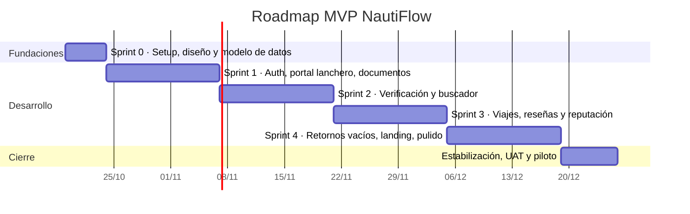

# 06 · Plan de implementación

**Producto:** NautiFlow · **Versión:** 1.0 (MVP) · **Fecha:** 16/10/2026

---

## 1. Resumen

| Concepto | Estimación |
|----------|-----------|
| Duración total del MVP | **8 semanas** (4 sprints de 2 semanas) + 1 semana de estabilización |
| Equipo de referencia | 1–2 backend, 1 frontend, 1 diseño UX/UI (part-time), 1 referente de la agencia (validación) |
| Entrega incremental | Cada sprint termina con una demo usable por la agencia |
| Estrategia | Vertical slices: cada sprint entrega flujos completos de punta a punta |

> Si el equipo es de una sola persona full-stack, duplicar los tiempos (≈ 14–16 semanas) manteniendo el mismo orden.

## 2. Roadmap

## 3. Sprint 0 — Fundaciones (1 semana)

**Objetivo:** que cualquier integrante pueda clonar, levantar y desplegar.

| # | Tarea | Resultado |
|---|-------|-----------|
| 0.1 | Monorepo (`apps/api`, `apps/web`), ESLint, Prettier, Husky | Repositorio base |
| 0.2 | Docker Compose con Postgres local + `.env.example` | Entorno reproducible |
| 0.3 | CI en GitHub Actions: lint + test + build | Pipeline verde |
| 0.4 | Servicios en Render (API, static site, Postgres) + R2 con 2 buckets | Entornos `staging` y `production` |
| 0.5 | Migraciones 001–003 y seeders de zonas y admin | Base inicial |
| 0.6 | Middlewares base: error handler, validación Zod, helmet, rate limit, pino | API esqueleto con `/health` |
| 0.7 | UI kit mínimo (tokens, botones, inputs, badges) + layout público/portal/admin | Base visual |
| 0.8 | Taller con la agencia: validar zonas, mensajes y preguntas abiertas del PRD §10 | Decisiones documentadas |

**Definición de terminado:** deploy automático a staging, login de admin sembrado funcionando.

## 4. Sprint 1 — Auth + Portal del lanchero (2 semanas)

**Objetivo:** un lanchero puede registrarse, cargar todo y ver su estado.

| # | Tarea | Referencia |
|---|-------|-----------|
| 1.1 | Auth: registro, login, logout, `/me`, recuperación de contraseña, bloqueo por intentos | A1 |
| 1.2 | RBAC y cookie httpOnly; guardas de rutas en el front | TRD §5.1 |
| 1.3 | CRUD de lancha, perfil del conductor, slug automático | A2 |
| 1.4 | Subida de fotos: validación magic bytes, sharp (WebP, sin EXIF), miniaturas, límites | A2, TRD §5.2 |
| 1.5 | Zonas y disponibilidad semanal (UI de franjas) | A3 |
| 1.6 | Subida de documentos al bucket privado + fechas de vencimiento + estados | A4 |
| 1.7 | Portal: resumen con checklist, re-subida, pausa/activación | A5, A6 |
| 1.8 | Emails transaccionales base (bienvenida, documento recibido) | — |
| 1.9 | Tests: auth, IDOR entre lancheros, uploads maliciosos | TRD §11 |

**Definición de terminado:** un lanchero de prueba completa el alta en móvil y su lancha queda `PENDING_REVIEW`.

## 5. Sprint 2 — Verificación y motor de búsqueda (2 semanas)

**Objetivo:** el admin verifica y encuentra lanchas rápido.

| # | Tarea | Referencia |
|---|-------|-----------|
| 2.1 | Cola de verificación y endpoint de URL firmada (TTL 5 min) con auditoría | B1, B2 |
| 2.2 | Visor de documentos (zoom, rotación, PDF, atajos de teclado) | B2 |
| 2.3 | Aprobar/rechazar documento con motivo; historial `document_reviews` | B3 |
| 2.4 | Verificar / rechazar / suspender lancha con precondiciones | B4, B5 |
| 2.5 | Emails de resultado al lanchero (aprobado / rechazado con motivo) | B3 |
| 2.6 | Job de vencimiento de documentos y recordatorios | B6 |
| 2.7 | Motor de búsqueda: SQL con filtros de capacidad, zona, horario, solapamiento, vigencia | C1 |
| 2.8 | UI del buscador + botón WhatsApp con mensaje prellenado | C2, C3 |
| 2.9 | Índices y prueba de rendimiento con 500 lanchas sintéticas (< 500 ms) | RNF |
| 2.10 | Tests: precondiciones de verificación, exclusión por solapamiento, vencidos | TRD §11 |

**Definición de terminado:** el admin verifica una lancha de punta a punta y la encuentra en el buscador.

## 6. Sprint 3 — Viajes, reseñas y reputación (2 semanas)

**Objetivo:** cerrar el ciclo de confianza.

| # | Tarea | Referencia |
|---|-------|-----------|
| 3.1 | CRUD de viajes y máquina de estados (solicitado → asignado → completado/cancelado) | D1–D4 |
| 3.2 | Asignar desde el buscador (panel lateral), detección de conflicto, forzar con nota | C4, D2 |
| 3.3 | Dashboard kanban del admin (columnas por estado) con polling 30 s | UX §4.7 |
| 3.4 | Generación de token (hash SHA-256, TTL 14 días, revocación del anterior) y link `/review/trip_…` | E1 |
| 3.5 | Mensaje de WhatsApp para el turista + botón copiar | E1 |
| 3.6 | Formulario móvil de un paso `/review/:token` (estrellas accesibles, estados de error) | E2, UX §4.3 |
| 3.7 | Endpoint público con rate limit, respuesta uniforme 404, honeypot, `noindex` | E3 |
| 3.8 | Reputación: recálculo transaccional, desnormalización, alerta de promedio bajo | E4, RN-07 |
| 3.9 | Email al lanchero por reseña nueva; vista de reseñas en el portal | E5, A7 |
| 3.10 | Moderación de reseñas (ocultar con motivo) | E6 |
| 3.11 | Tests críticos: reutilización de token, concurrencia (2 envíos simultáneos), promedio con reseñas ocultas | TRD §11 |

**Definición de terminado:** un viaje completado genera un link, el turista califica desde un celular y el promedio cambia en la base y en el panel.

## 7. Sprint 4 — Retornos vacíos, landing y pulido (2 semanas)

**Objetivo:** capitalizar los fletes muertos y abrir la cara pública.

| # | Tarea | Referencia |
|---|-------|-----------|
| 4.1 | Modelo y API de tramos vacíos; generación de mensaje con plantilla única | F1, F2 |
| 4.2 | Botón **"Publicar Retorno Vacío"** en el viaje + modal con vista previa y copiado | UX §4.8 |
| 4.3 | Columna "Retornos vacíos" en el dashboard + acciones (ofrecido, ocupado, cancelar) | F3, F4 |
| 4.4 | Job de expiración de tramos | RN-08 |
| 4.5 | Landing pública: hero, destacadas, cómo funciona, reseñas | G1 |
| 4.6 | Listado `/lanchas` con filtros y perfil `/lanchas/:slug` con galería y reseñas paginadas | G1, G2 |
| 4.7 | SEO básico: metadatos, Open Graph, `sitemap.xml`, datos estructurados `AggregateRating` | TRD §1 |
| 4.8 | CTA de WhatsApp de la agencia; verificar que ninguna respuesta pública exponga teléfonos | G3 |
| 4.9 | Auditoría de accesibilidad (axe) y de rendimiento (Lighthouse ≥ 90 móvil en landing y formulario) | RNF |
| 4.10 | Pulido de UX: skeletons, estados vacíos, microcopy, errores | UX §5, §8 |

**Definición de terminado:** flujo completo de los 7 puntos del flujo técnico funcionando en staging.

## 8. Semana de estabilización y piloto

| # | Actividad |
|---|-----------|
| 5.1 | Prueba E2E con Playwright de todo el flujo y casos negativos |
| 5.2 | Revisión de seguridad: checklist OWASP ASVS nivel 1, `npm audit`, permisos de buckets, rotación de secretos |
| 5.3 | Backups y prueba de restauración de PostgreSQL |
| 5.4 | UAT con la agencia usando 5–10 lancheros reales |
| 5.5 | Capacitación de 1 hora al admin + guía breve (PDF/video) |
| 5.6 | Aviso de privacidad y términos para lancheros (revisión legal) |
| 5.7 | Plan de monitoreo (Sentry, alertas de 5xx, uptime) |
| 5.8 | Go-live y hypercare de 2 semanas |

## 9. Distribución sugerida por rol

| Rol | Sprint 0 | Sprint 1 | Sprint 2 | Sprint 3 | Sprint 4 |
|-----|----------|----------|----------|----------|----------|
| Backend | Setup, DB, CI | Auth, uploads, docs | Verificación, búsqueda | Viajes, tokens, reputación | Retornos vacíos, API pública |
| Frontend | UI kit, layouts | Portal lanchero | Visor, buscador | Dashboard, formulario móvil | Landing, perfil, pulido |
| UX/UI | Taller + wireframes | Portal + prototipo | Admin | Reseña móvil | Landing + pruebas de usabilidad |
| QA | Plan de pruebas | Casos de seguridad | Casos de búsqueda | Concurrencia y tokens | E2E y accesibilidad |

## 10. Definition of Done (global)

- [ ] Criterios de aceptación de la historia cumplidos.
- [ ] Validación de entrada con Zod y manejo de errores consistente.
- [ ] Autorización probada (rol + propiedad del recurso).
- [ ] Tests unitarios/integración en verde, cobertura de servicios críticos ≥ 80 %.
- [ ] Sin secretos en el repositorio; variables documentadas en `.env.example`.
- [ ] Migración reversible incluida.
- [ ] Revisión de código por otra persona.
- [ ] Probado en móvil (iOS Safari y Android Chrome) las pantallas públicas y del portal.
- [ ] Documentación de endpoints actualizada (OpenAPI).
- [ ] Desplegado en staging y validado.

## 11. Riesgos de ejecución

| Riesgo | Prob. | Impacto | Respuesta |
|--------|:----:|:-------:|-----------|
| Alcance se expande (ej. pedir pagos o GPS) | Alta | Alto | Congelar alcance con el PRD §4.2; backlog post-MVP |
| Retrasos en el contenido real (zonas, fotos, textos) | Media | Medio | Contenido semilla desde el Sprint 0; carga real en el piloto |
| Documentos con formatos raros (fotos torcidas, PDFs grandes) | Alta | Bajo | Rotación en el visor, límites claros y mensajes de error |
| Problemas de entrega de emails (spam) | Media | Medio | Configurar SPF/DKIM/DMARC desde el Sprint 0 |
| Baja adopción de lancheros | Media | Alto | Alta asistida por la agencia (WhatsApp), portal simple y móvil |
| Dependencia de un único admin | Media | Medio | Roles listos para sumar admins; manual de operación |

## 12. Post-MVP (backlog priorizado)

| Prioridad | Idea | Valor |
|:--------:|------|-------|
| 1 | Recordatorio automático de reseña a las 48 h (manual asistido primero) | Más respuestas |
| 2 | Calendario de disponibilidad por fecha (bloqueos puntuales y feriados) | Búsqueda más precisa |
| 3 | Respuesta pública del lanchero a una reseña | Profesionalización |
| 4 | Reutilizar documentos del lanchero entre varias lanchas | Menos carga |
| 5 | Reportes: ocupación de flota, ingresos por retornos vacíos, tiempos de verificación | Gestión |
| 6 | Promedio ponderado (suavizado bayesiano) para lanchas con pocas reseñas | Ranking más justo |
| 7 | Exportar solicitudes y viajes a CSV | Contabilidad |
| 8 | WhatsApp Business API para mensajes con plantilla | Menos pasos manuales |
| 9 | Multiidioma (inglés/portugués) para la landing | Turismo internacional |
| 10 | Roles adicionales (operador sin acceso a documentos) | Principio de mínimo privilegio |

## 13. Presupuesto de infraestructura estimado (referencial)

| Servicio | Plan inicial | Costo mensual aprox. |
|----------|-------------|----------------------|
| Render Web Service (API) | Starter | USD 7–25 |
| Render Static Site | Gratis | USD 0 |
| Render PostgreSQL | Basic | USD 7–20 |
| Cloudflare R2 | Pago por uso | < USD 5 |
| Resend | Free (3.000 mails/mes) | USD 0–20 |
| Sentry | Free | USD 0 |
| Dominio | — | ≈ USD 1–2 |
| **Total** | | **≈ USD 20–70** |

> Los valores son orientativos y deben verificarse con las tarifas vigentes de cada proveedor al momento de contratar.
